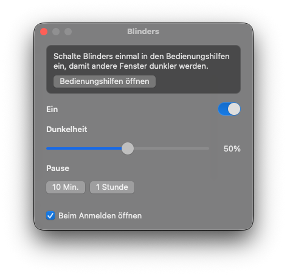

<p align="center">
  
</p>

<h1 align="center">Blinders</h1>

<p align="center">
  <b>Nur das Fenster, in dem du arbeitest, bleibt hell.</b><br>
  Eine kleine Mac-App für den Fokus. Das vordere Fenster bleibt hell. Der Rest wird dunkel.
</p>

<p align="center">
  
  
  
  
</p>

<p align="center">
  <a href="README.md">English</a> ·
  <a href="README.ko.md">한국어</a> ·
  <a href="README.ja.md">日本語</a> ·
  <a href="README.zh-CN.md">简体中文</a> ·
  <a href="README.es.md">Español</a> ·
  <b>Deutsch</b> ·
  <a href="README.fr.md">Français</a>
</p>

<p align="center">
  
</p>

## Warum

Wie Scheuklappen beim Rennpferd: Das Fenster, das du benutzt, bleibt hell, der Rest des Schreibtischs wird ruhig. Andere Fenster und der Schreibtisch bleiben da. Sie sind nur abgedunkelt. Kein Konto, keine Telemetrie.

## Funktionen

- **Fokus-Dimmung.** Das vordere Fenster bleibt hell. Andere Fenster und der Schreibtisch werden auf jedem Display dunkler.
- **Menüleiste und Dock bleiben hell.**
- **Dunkelheit** von 10% bis 90%. Standard ist 50%.
- **Pause** für 10 Minuten oder 1 Stunde.
- **Beim Anmelden öffnen,** nachdem die App in `/Applications` liegt.
- **Menüleiste und Dock.** Jedes lässt sich ein- oder ausblenden. Eines bleibt sichtbar, damit sich Blinders wieder öffnen lässt.
- **Ein Klick auf den Schreibtisch** nimmt die Abdunklung weg. Ein neues Fenster holt sie zurück.
- **Hat die vordere App kein Fenster,** wird der ganze Bildschirm dunkel.
- **Vollbild:** Ein Display, das das vordere Fenster füllt, bleibt hell. Die anderen bleiben gedimmt.

## Download

1. Lade `Blinders-0.1.0.zip` unter [Releases](../../releases) herunter.
2. Entpacke die Datei und lege `Blinders.app` nach `/Applications`.
3. Klicke die App mit der rechten Maustaste an und wähle **Öffnen**, dann noch einmal **Öffnen**. Sie ist noch nicht notarisiert, deshalb braucht der erste Start diesen Extra-Klick.
4. Öffne **Systemeinstellungen → Datenschutz & Sicherheit → Bedienungshilfen** und schalte Blinders ein. Wenn der Schalter schon an ist und nichts dunkler wird, schalte ihn aus und wieder ein.

Das Dock-Symbol ist ein Fenster, halb hell und halb dunkel. Ein Klick auf das Dock-Symbol oder auf **B** in der Menüleiste öffnet die Einstellungen.

## Bauen

```bash
./scripts/bundle.sh
open build/Blinders.app
```

Ein neuer Build ändert die Signatur. Bedienungshilfen müssen danach aus- und wieder eingeschaltet werden.

## Lizenz

[MIT](LICENSE) © 2026 Joonit
