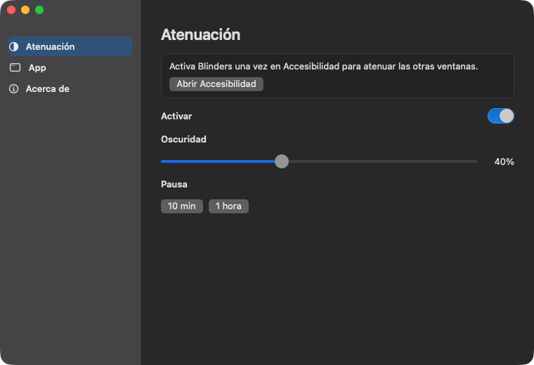

<p align="center">
  
</p>

<h1 align="center">Blinders</h1>

<p align="center">
  <b>Deja brillante solo la ventana en la que trabajas.</b><br>
  Una app pequeña de Mac para concentrarte. La ventana de delante sigue clara. El resto se oscurece.
</p>

<p align="center">
  
  
  
  
</p>

<p align="center">
  <a href="README.md">English</a> ·
  <a href="README.ko.md">한국어</a> ·
  <a href="README.ja.md">日本語</a> ·
  <a href="README.zh-CN.md">简体中文</a> ·
  <b>Español</b> ·
  <a href="README.de.md">Deutsch</a> ·
  <a href="README.fr.md">Français</a>
</p>

<p align="center">
  
</p>

## Por qué

Como las anteojeras de un caballo de carreras: la ventana que usas se queda brillante y el resto del escritorio se calla. Las otras ventanas y el escritorio siguen ahí. Solo están más oscuros. Sin cuenta y sin telemetría.

## Funciones

- **Atenuación del foco.** La ventana de delante sigue brillante. Las demás ventanas y el escritorio se atenúan en todas las pantallas.
- **La barra de menús y el Dock siguen brillantes.**
- **Oscuridad** del 10% al 90%. El valor inicial es 50%.
- **Pausa** de 10 minutos o 1 hora.
- **Abrir al iniciar sesión,** después de colocar la app en `/Applications`.
- **Barra de menús y Dock.** Se pueden mostrar u ocultar por separado. Uno de los dos sigue visible para poder abrir Blinders.
- **Un clic en el escritorio** quita la sombra. Al elegir otra ventana, vuelve.
- **Si la app de delante no tiene ventana,** se oscurece toda la pantalla.
- **Pantalla completa:** la pantalla ocupada por la ventana de delante se queda brillante. Las otras siguen atenuadas.

## Descargar

1. Descarga `Blinders-0.1.2.zip` desde [Releases](../../releases).
2. Descomprime y mueve `Blinders.app` a `/Applications`.
3. Haz clic derecho en la app y elige **Abrir**, y luego **Abrir** otra vez. Aún no está notarizada, así que el primer arranque pide ese clic extra.
4. Abre **Ajustes del Sistema → Privacidad y seguridad → Accesibilidad** y activa Blinders. Si el interruptor ya está activo y no se oscurece nada, apágalo y vuelve a encenderlo.

El icono del Dock es una ventana partida en una mitad clara y una mitad oscura. Pulsa el icono del Dock, o la **B** de la barra de menús, para abrir los ajustes.

## Compilar

```bash
./scripts/bundle.sh
open build/Blinders.app
```

Una compilación nueva cambia la firma, así que hay que apagar y volver a encender Accesibilidad.

## Licencia

[MIT](LICENSE) © 2026 Joonit
