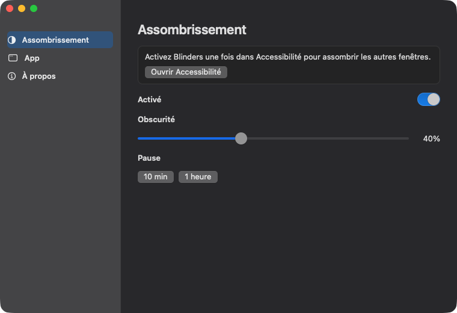

<p align="center">
  
</p>

<h1 align="center">Blinders</h1>

<p align="center">
  <b>Seule la fenêtre utilisée reste claire.</b><br>
  Une petite app Mac pour rester concentré. La fenêtre de devant reste claire. Le reste s'assombrit.
</p>

<p align="center">
  
  
  
  
</p>

<p align="center">
  <a href="README.md">English</a> ·
  <a href="README.ko.md">한국어</a> ·
  <a href="README.ja.md">日本語</a> ·
  <a href="README.zh-CN.md">简体中文</a> ·
  <a href="README.es.md">Español</a> ·
  <a href="README.de.md">Deutsch</a> ·
  <b>Français</b>
</p>

<p align="center">
  
</p>

## Pourquoi

Comme les œillères d'un cheval de course : la fenêtre utilisée reste claire, et le reste du bureau se tait. Les autres fenêtres et le bureau sont toujours là. Ils sont seulement assombris. Pas de compte, pas de télémétrie.

## Fonctions

- **Assombrissement du focus.** La fenêtre de devant reste claire. Les autres fenêtres et le bureau s'assombrissent sur chaque écran.
- **La barre des menus et le Dock restent clairs.**
- **Obscurité** de 10 % à 90 %. La valeur de départ est 50 %.
- **Pause** de 10 minutes ou 1 heure.
- **Ouverture à la connexion,** une fois l'app placée dans `/Applications`.
- **Barre des menus et Dock.** Chacun peut être affiché ou masqué. L'un des deux reste visible pour rouvrir Blinders.
- **Un clic sur le bureau** retire l'ombre. Choisir une fenêtre la fait revenir.
- **Si l'app de devant n'a pas de fenêtre,** tout l'écran s'assombrit.
- **Plein écran :** l'écran rempli par la fenêtre de devant reste clair. Les autres restent assombris.

## Télécharger

1. Téléchargez `Blinders-0.1.0.zip` depuis [Releases](../../releases).
2. Décompressez et placez `Blinders.app` dans `/Applications`.
3. Cliquez l'app avec le bouton droit et choisissez **Ouvrir**, puis **Ouvrir** encore. Elle n'est pas encore notarisée, donc le premier lancement demande ce clic en plus.
4. Ouvrez **Réglages Système → Confidentialité et sécurité → Accessibilité** et activez Blinders. Si l'interrupteur est déjà activé et que rien ne s'assombrit, désactivez-le puis réactivez-le.

L'icône du Dock est une fenêtre coupée en une moitié claire et une moitié sombre. Cliquez l'icône du Dock, ou le **B** de la barre des menus, pour ouvrir les réglages.

## Compiler

```bash
./scripts/bundle.sh
open build/Blinders.app
```

Une nouvelle compilation change la signature. Il faut alors désactiver puis réactiver Accessibilité.

## Licence

[MIT](LICENSE) © 2026 Joonit
