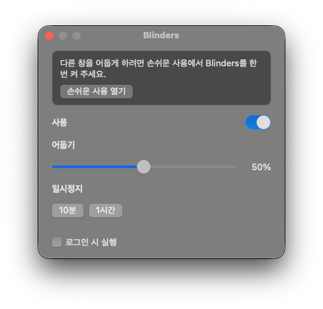

<p align="center">
  
</p>

<h1 align="center">Blinders</h1>

<p align="center">
  <b>作業中のウィンドウだけを明るく残します。</b><br>
  集中のための小さな Mac アプリです。前面のウィンドウは明るく、ほかは暗くなります。
</p>

<p align="center">
  
  
  
  
</p>

<p align="center">
  <a href="README.md">English</a> ·
  <a href="README.ko.md">한국어</a> ·
  <b>日本語</b> ·
  <a href="README.zh-CN.md">简体中文</a> ·
  <a href="README.es.md">Español</a> ·
  <a href="README.de.md">Deutsch</a> ·
  <a href="README.fr.md">Français</a>
</p>

<p align="center">
  
</p>

## なぜ

競走馬の遮眼革のように、今使っているウィンドウだけが明るく、机のほかは静かになります。ほかのウィンドウとデスクトップはそのままです。暗くなるだけです。アカウントも計測もありません。

## 機能

- **集中ディミング。** 前面のウィンドウは明るく、ほかのウィンドウとデスクトップはすべてのディスプレイで暗くなります。
- **メニューバーと Dock は明るいままです。**
- **暗さ**は 10% から 90%。初期値は 50% です。
- **一時停止**は 10 分または 1 時間。
- **ログイン時に開く**は、アプリを `/Applications` に置いてから使えます。
- **デスクトップをクリック**するとシェードが消えます。ウィンドウを選び直すと戻ります。
- **前面のアプリにウィンドウがない**ときは画面全体を暗くします。
- **フルスクリーン**の前面ウィンドウがあるディスプレイは明るく保ち、ほかのディスプレイは暗いままです。

## ダウンロード

1. [Releases](../../releases) から `Blinders-0.1.0.zip` をダウンロードします。
2. 解凍して `Blinders.app` を `/Applications` に移動します。
3. アプリを右クリックして **開く** を二度選びます。まだ公証されていないため、初回だけこの操作が必要です。
4. **システム設定 → プライバシーとセキュリティ → アクセシビリティ** で Blinders をオンにします。オンなのに暗くならないときは、一度オフにしてからオンにします。

Dock アイコンは、明るい半分と暗い半分に分かれたウィンドウです。Dock アイコンかメニューバーの **B** で設定が開きます。

## ビルド

```bash
./scripts/bundle.sh
open build/Blinders.app
```

ビルドし直すと署名が変わるため、アクセシビリティをオフにしてからオンにし直してください。

## ライセンス

[MIT](LICENSE) © 2026 Joonit
