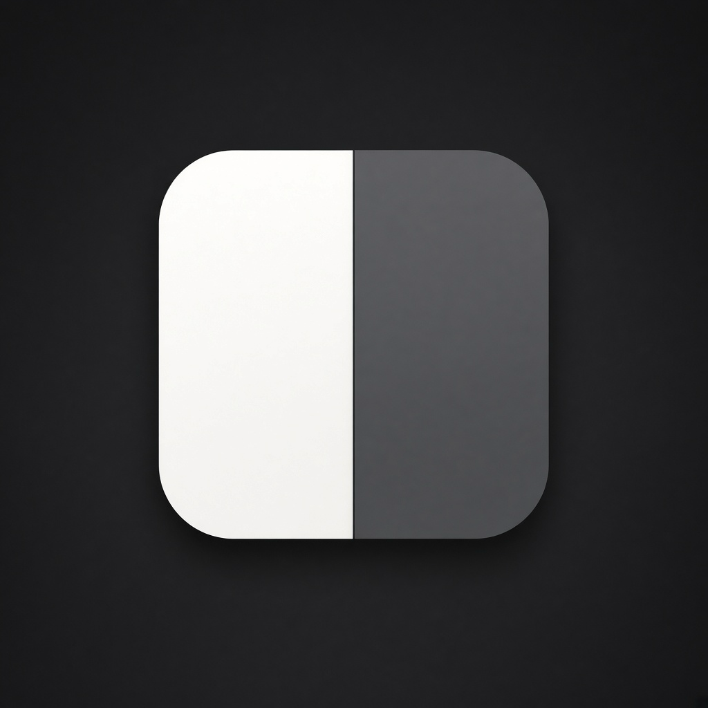
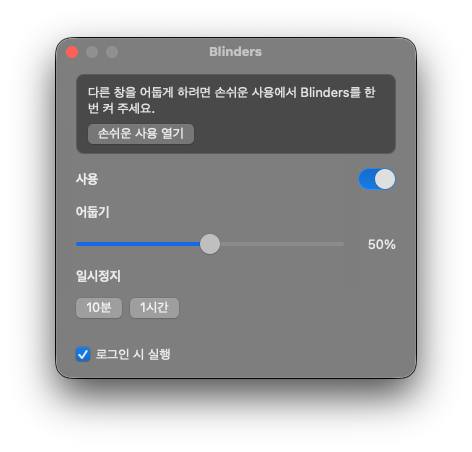

<p align="center">
  
</p>

<h1 align="center">Blinders</h1>

<p align="center">
  <b>쓰는 창만 밝게 둡니다.</b><br>
  집중을 위한 작은 맥 앱입니다. 앞 창은 밝고, 나머지는 어두워집니다.
</p>

<p align="center">
  
  
  
  
</p>

<p align="center">
  <a href="README.md">English</a> ·
  <b>한국어</b> ·
  <a href="README.ja.md">日本語</a> ·
  <a href="README.zh-CN.md">简体中文</a> ·
  <a href="README.es.md">Español</a> ·
  <a href="README.de.md">Deutsch</a> ·
  <a href="README.fr.md">Français</a>
</p>

<p align="center">
  
</p>

## 왜

경주마의 차안대처럼, 지금 쓰는 창만 밝고 나머지 책상은 조용해집니다. 다른 창과 바탕화면은 그대로 있습니다. 어두울 뿐입니다. 계정과 수집 데이터는 없습니다.

## 기능

- **집중 딤.** 앞 창은 밝게, 다른 창과 바탕화면은 모든 화면에서 어둡게.
- **메뉴막대와 Dock은 밝게 둡니다.**
- **어둡기**는 10%에서 90%까지. 기본값은 50%입니다.
- **일시정지**는 10분 또는 1시간.
- **로그인 시 실행**은 앱을 `/Applications`에 넣은 뒤 켤 수 있습니다.
- **바탕화면을 클릭**하면 막이 걷힙니다. 창을 다시 고르면 돌아옵니다.
- **앞 앱에 창이 없으면** 화면 전체를 어둡게 합니다. 뒤 앱을 쓰는 창으로 오해하지 않기 위해서입니다.
- **전체화면**인 앞 창이 있는 화면은 밝게 두고, 다른 화면은 계속 어둡게 합니다.

## 받기

1. [Releases](../../releases)에서 `Blinders-0.1.0.zip`을 받습니다.
2. 압축을 풀고 `Blinders.app`을 `/Applications`로 옮깁니다.
3. 앱을 오른쪽 클릭해서 **열기**를 두 번 누릅니다. 아직 공증되지 않아 첫 실행만 이렇게 합니다.
4. **시스템 설정 → 개인정보 보호 및 보안 → 손쉬운 사용**에서 Blinders를 켭니다. 이미 켜져 있는데 어두워지지 않으면 한 번 끄고 다시 켭니다.

Dock 아이콘은 반쪽은 밝고 반쪽은 어두운 창입니다. Dock 아이콘이나 메뉴막대의 **B**를 누르면 설정이 열립니다.

## 빌드

```bash
./scripts/bundle.sh
open build/Blinders.app
```

새로 빌드하면 서명이 바뀌므로, 손쉬운 사용을 끄고 다시 켜야 합니다.

## 라이선스

[MIT](LICENSE) © 2026 Joonit
