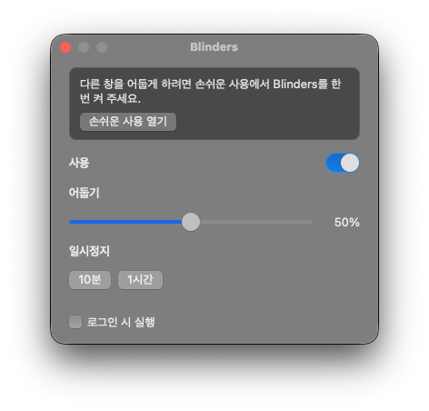

<p align="center">
  
</p>

<h1 align="center">Blinders</h1>

<p align="center">
  <b>Dim everything except the window you're working in.</b><br>
  A small Mac app for focus. The front window stays bright. Everything else fades.
</p>

<p align="center">
  
  
  
  
</p>

<p align="center">
  <b>English</b> ·
  <a href="README.ko.md">한국어</a> ·
  <a href="README.ja.md">日本語</a> ·
  <a href="README.zh-CN.md">简体中文</a> ·
  <a href="README.es.md">Español</a> ·
  <a href="README.de.md">Deutsch</a> ·
  <a href="README.fr.md">Français</a>
</p>

<p align="center">
  
</p>

## Why

Like blinders on a racehorse: the window you are using stays bright, and the rest of the desk goes quiet. Other windows and the desktop are still there. They are just dim. One app, no account, no telemetry.

## Features

- **Focus dimming.** The front window stays bright. Other windows and the desktop dim, on every display.
- **Menu bar and Dock stay bright.**
- **Darkness** slider from 10% to 90%. The default is 50%.
- **Pause** for 10 minutes or 1 hour.
- **Launch at login,** after the app is in `/Applications`.
- **Desktop click** clears the shade. Choose a window again and it returns.
- **No window in front:** the whole screen dims, so a background app is not treated as the one you are using.
- **Fullscreen:** a front window that fills a display leaves that display bright. Other displays keep dimming.

## Download

1. Download `Blinders-0.1.0.zip` from [Releases](../../releases).
2. Unzip it and move `Blinders.app` to `/Applications`.
3. Right-click the app and choose **Open**, then **Open** again. It is not notarized yet, so the first launch needs that extra click.
4. Open **System Settings → Privacy & Security → Accessibility** and turn Blinders on. If the switch is already on and nothing dims, turn it off and on once.

The Dock icon is a window split into a bright half and a dim half. Click it, or click **B** in the menu bar, to open settings.

## Build

```bash
./scripts/bundle.sh
open build/Blinders.app
```

A new build changes the code signature, so Accessibility must be turned off and on again.

## License

[MIT](LICENSE) © 2026 Joonit
