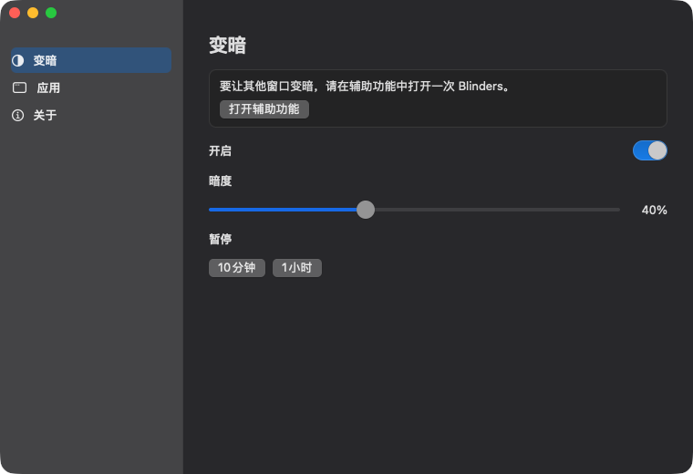

<p align="center">
  
</p>

<h1 align="center">Blinders</h1>

<p align="center">
  <b>只让正在使用的窗口保持明亮。</b><br>
  一个帮助专注的小型 Mac 应用。前台窗口保持明亮，其余变暗。
</p>

<p align="center">
  
  
  
  
</p>

<p align="center">
  <a href="README.md">English</a> ·
  <a href="README.ko.md">한국어</a> ·
  <a href="README.ja.md">日本語</a> ·
  <b>简体中文</b> ·
  <a href="README.es.md">Español</a> ·
  <a href="README.de.md">Deutsch</a> ·
  <a href="README.fr.md">Français</a>
</p>

<p align="center">
  
</p>

## 为什么

像赛马的眼罩：正在使用的窗口保持明亮，桌面的其余部分安静下来。其他窗口和桌面还在，只是变暗了。没有账号，也不收集数据。

## 功能

- **专注变暗。** 前台窗口保持明亮，其他窗口和桌面在每台显示器上变暗。
- **菜单栏和程序坞保持明亮。**
- **暗度**从 10% 到 90%，默认 50%。
- **暂停** 10 分钟或 1 小时。
- **登录时打开**需要先把应用放进 `/Applications`。
- **菜单栏和程序坞。** 可以分别显示或隐藏，至少保留一个，这样之后还能打开。
- **点击桌面**会收起遮罩。再次选中窗口后恢复。
- **前台应用没有窗口时**整屏变暗，避免把后台应用当成正在使用的窗口。
- **全屏：** 被前台窗口铺满的显示器保持明亮，其他显示器继续变暗。

## 下载

1. 从 [Releases](../../releases) 下载 `Blinders-0.1.0.zip`。
2. 解压后把 `Blinders.app` 移到 `/Applications`。
3. 右键应用，选择**打开**，再选择一次**打开**。应用尚未公证，所以第一次需要多点一次。
4. 打开**系统设置 → 隐私与安全性 → 辅助功能**，打开 Blinders。如果开关已经打开但没有变暗，请先关闭再打开。

程序坞图标是一扇左亮右暗的窗户。点程序坞图标，或点菜单栏上的 **B**，即可打开设置。

## 构建

```bash
./scripts/bundle.sh
open build/Blinders.app
```

重新构建会改变代码签名，需要在辅助功能里先关闭再打开 Blinders。

## 许可证

[MIT](LICENSE) © 2026 Joonit
